# Claims register — argument spine

**Purpose.** One reference file for every load-bearing assertion in this project, tagged with a
math-proof-style *kind* (axiom, definition, observation, lemma, theorem, corollary, conjecture,
counterexample) so that (a) authors can keep track of what is established, assumed, or predicted, and
(b) readers can build the argument step by step: later claims cite the earlier claims they rest on.

This is **not** a second TODO or a new source catalogue. Source IDs stay where they are
(`VI##` for Isolation papers, `P1-###`/`P2-###`/`P3-###` for screened sources, tier A–D for R2
controls, `R*`/`P*` for streams). A claim ID points *at* sources; it does not replace them.

## Code scheme (kind-prefixed) + table of contents

Each claim carries a **kind-prefixed** code. The numeric portion is identical to the old `C###` numeric
portion (1:1 mapping `C020` → `OB020`), so stream references update by swapping only the prefix.

| Kind | Prefix | Count | Example |
|------|--------|-------|---------|
| Definition | `DEF` | `DEF001`–`DEF006` | DEF001 Isolation |
| Axiom | `AX` | `AX010`–`AX012` | AX010 Pipeline scope |
| Observation | `OB` | `OB020`–`OB028`, `OB080`, `OB081` | OB020 corpus modal 10%→2% |
| Lemma | `LM` | `LM030`–`LM034` | LM030 practice follows recipe |
| Theorem | `TH` | `TH040` | TH040 serum step-down drives CPE |
| Corollary | `CRL` | `CRL041`–`CRL043` | CRL041 CPE not inoculum-specific |
| Conjecture | `CNJ` | `CNJ050`–`CNJ057`, `CNJ150`, `CNJ151` | CNJ053 genome inherits endpoint |
| Counterexample (adversarial) | `ADVR` | `ADVR060`–`ADVR062` | ADVR060 not all practice steps down |

TOC (links jump to the section): [Definitions](#definitions) · [Axioms](#axioms-premises--scope) ·
[Observations](#observations-empirical-facts) · [Lemmas](#lemmas-supporting-established-findings) ·
[Theorem](#theorem) · [Corollaries](#corollaries) · [Conjectures](#conjectures-predictions-p-arms) ·
[Counterexamples](#counterexamples-adversarial-balance) · [Dependency index](#dependency-index-build-order) ·
[Rules of use](#rules-of-use)

## Kind vocabulary

| Kind | Proof-library meaning | Meaning here | Sets the bar |
|------|----------------------|--------------|--------------|
| **Axiom** | assumed, not proved | Stated premise / scope assumption the argument takes as given | Must be explicit; not a result |
| **Definition** | stipulated term | Stipulated meaning of a term ("Isolation", "CPE", tier A–D) | Just a definition, nothing empirical |
| **Observation** | recorded datum | A descriptive empirical fact from a corpus/experiment | Evidence-tagged; survives or falls on the source |
| **Lemma** | supporting result | An established finding that is not the headline but feeds a theorem | Evidence-backed; conservative |
| **Theorem** | main proved result | The central claim the paper is built to establish | Evidence-backed across the cited streams |
| **Corollary** | near-direct consequence | An inference that follows cheaply from a theorem/lemma | Must name exactly which claims it follows from |
| **Conjecture** | proposed, unproven | A directional prediction (the P1–P7 arms) | Marked "predicted"; strengthen/weaken log lives in the stream |
| **Counterexample** | refuting instance | An adversarial case that resists a pattern | Kept visible so the paper is not one-sided |

## Field schema

Each entry: `ID · Kind` — **Slug.** Statement. *(Follows from …; Evidence …; Status …; Stream …)*

- **ID:** `DEF###` / `AX###` / `OB###` / `LM###` / `TH###` / `CRL###` / `CNJ###` / `ADVR###`. Cite the
  code in notes and in `tex/` (can become a `\label`). For backward search, `grep "C###"` still finds old refs.
- **Follows from:** the claim IDs this one rests on (the dependency arrows of the build).
- **Evidence:** one of the house tags `[VERIFIED src]` (read in the full document), `[FIGURE]`,
  `[SUPPLIER]`, `[IN-HOUSE]`, `[UNVERIFIED]`, `[DATA REQUIRED]`, plus a source pointer (corpus file /
  snippet / bibliography). **Abstract-only research is not allowed**: an abstract may identify a source but
  not ground a claim. A claim that rests only on an abstract is `[DATA REQUIRED]` until the full text is
  read. `[VERIFIED-ABSTRACT]` is retained only as a legacy provenance marker for pre-existing
  abstract-derived material, never as a tag for a new claim.
- **Status:** `stipulated` | `assumed` | `established` | `established-scoped` | `provisional` | `predicted` |
  `rejected`.
- **Stream(s):** which stream owns the evidence (R1–R4, P1–P7).

---

## Definitions

- **DEF001 · Definition** — **Isolation.** Capital-I Isolation is the operational product
  *culture → cytopathic readout → passage* (an **Isolate**); it does not mean chemical purity.
  *(Evidence: house convention; Status: stipulated; Streams: all — source r1.md snippet R1-S2.)*

- **DEF002 · Definition** — **CPE.** "Cytopathic / cytopathogenic effect" is the morphologic change read
  in an inoculated monolayer as the primary indicator of viral presence in institutional guidance.
  *(Evidence: [VERIFIED src] ATCC, CLSI M41-A §7.4.2, ASM CPE protocols; Status: stipulated; Streams: R1, R3.)*

- **DEF003 · Definition** — **Maintenance medium.** The post-growth / infection-stage medium, typically lower
  in serum/enrichment than growth medium (institutional recipes use 1–3%, commonly 2% FBS).
  *(Evidence: [VERIFIED src] CLSI M41-A §5.4.1; Status: stipulated; Streams: R1, R4.)*

- **DEF004 · Definition** — **Negative-control tiers A–D.** A = Isolation-stage mock in matched maintenance
  medium; B = named but match unverifiable; C = wrong stage and/or explicit mismatch; D = none described.
  *(Evidence: house framework `r2_negative_controls/control-cultures.md`; Status: stipulated; Stream: R2.)*

- **DEF005 · Definition** — **Assembly fragility.** *(Short)* The deposited "complete genome" was built wrong.
  *(Long)* The published full-genome assembly of a named, culture-derived type material is later shown incorrect
  or incomplete — a missing gene-containing segment (CMV AD169 absent 929 bp affecting UL42/UL43), accumulated
  sequencing errors (HPV16, human adenovirus 17, AAV2, the adenovirus "four errors" corrected by Jung 1991, the
  HVT frameshift), a mis-sized genome (FMDV O1K poly(C) length corrected 7802→~8450 nt), or a retracted
  infectious clone (measles Edmonston, Ballart 1990 retracted 1991) — and the correction is itself published, so
  the error is *detectable*, not hidden. *(Evidence: [VERIFIED src] A3 census
  `sequence_origins/P3_A3_census_2026-11-13.md`; Status: stipulated — taxonomy; Stream P3.)*

- **DEF006 · Definition** — **Stock drift.** *(Short)* The culture product itself is not a fixed object.
  *(Long)* When "the same" named stock / isolate is re-sequenced, or held and passaged in different laboratories,
  the biological material has itself diverged — through passage and adaptation (CMV AD169 high-passage vs
  low-passage Merlin), lab-to-lab drift (AD169 varUC vs ATCC holdings), culture adaptation (HAV HM-175 wild-type
  vs cell-adapted attenuated), or residual population heterogeneity (MDV CVI988 consensus differing at 236
  positions / 13 ORFs across three holdings; Ad2 "heterogeneity persists after plaque purification") — so
  independent sequences differ because the stock drifted, not because a data-handling step failed. The "reference
  genome" is therefore a passage-drifted, lab-specific snapshot, not a stable natural identifier — a process
  critique, not a "virus is broken" claim. *(Evidence: [VERIFIED src] A3 census
  `sequence_origins/P3_A3_census_2026-11-13.md`; Status: stipulated — taxonomy; Stream P3.)*

## Axioms (premises / scope)

- **AX010 · Axiom** — **Pipeline scope.** The argument is bounded to the classical
  *culture → CPE → purify → name particles → sequence* pipeline; it does not claim anything about
  other detection routes or about etiology as a whole.
  *(Evidence: —; Status: assumed; Streams: all.)*

- **AX011 · Axiom** — **Non-specificity is not non-existence.** Showing that CPE under Isolation conditions
  is not a virus-specific detector does not assert that "nothing infectious exists" in any system.
  *(Evidence: —; Status: assumed; Streams: all.)*

- **AX012 · Axiom** — **Scope exclusions.** HIV and phage are out of scope for the particle/sequence
  ontology arms; nucleic-acid existence is taken as given for the P3 arm.
  *(Evidence: `P4_P7_index.md` rules; Status: assumed; Streams: P2–P7.)*

## Observations (empirical facts)

- **OB020 · Observation** — **Dual-FBS corpus is modal 10% → 2%.** Across the 189-row Isolation corpus,
  169 papers state numeric pre- and post-inoculation serum and are plotted: pre-inoculation serum is
  modal 10% (139/169), post-inoculation modal 2% (113/169), with medians 10.0% and 2.0% and means
  9.30% and 2.24%. *(Evidence: [FIGURE] `r1_…/isolation-refs.csv`, `fbs_distribution_plots/fbs_distribution_summary.txt`;
  Status: established; Stream: R1.)*

- **OB021 · Observation** — **Guidelines overlay at ~10% → ~2%.** Eight institutional recipes with parseable
  dual percentages cluster at the same growth→maintenance split (about 10% to about 2%).
  *(Evidence: [VERIFIED src] quotes in `tex/DRAFT.md`; Status: established; Stream: R1.)*

- **OB022 · Observation** — **Same step, different stated reasons.** The guidelines that prescribe a serum
  step-down at inoculation agree on the target but not the rationale: ATCC cites interference with
  attachment; CLSI cites cell viability, slower overgrowth, and serum-borne inhibitors; ASM, NEADL, and
  WOAH give none.
  *(Evidence: [VERIFIED src] quoted passages in `tex/DRAFT.md`, table `tex/tables/rationale.tex`; Status: established; Stream: R1.)*

- **OB023 · Observation** — **Matched-medium controls are rare.** Of the scored Isolation-paper rows
  (~173), 11 are Tier A (matched-maintenance mock), 38 Tier B (match unverifiable), 14 Tier C (wrong
  stage/mismatch), 110 Tier D (none described). No Tier A paper reports CPE in its negative control.
  *(Evidence: [VERIFIED corpus] `r2_…/control-cultures-overview.csv`; Status: established; Stream: R2.
  Canonical pass = 173 rows (A/B/C/D 11/38/14/110).)*

- **OB024 · Observation** — **CRO medium-only effect (A vs B).** On the 22 CRO-described frames, CPE-type
  terms were named on 1 of 9 Culture A (10% FBS) and 10 of 13 Culture B (2% FBS) frames; Culture B's
  terms include rounded (8), dying cells (7), granularity (6), vacuolation (4), detached (2), refractile (1).
  *(Evidence: [SUPPLIER]/[IN-HOUSE] CRO descriptions; Status: established; Stream: R3.)*

- **OB025 · Observation** — **Blinded raters score more CPE on B.** IR1 mean CPE-item sums 0.87 (A) vs
  1.65 (B); IR2 2.41 (A) vs 4.91 (B). Item-level feature agreement is low even where direction agrees.
  *(Evidence: [IN-HOUSE] `r3_…/ir-results/`; Status: established; Stream: R3.)*

- **OB026 · Observation** — **A non-Isolation protocol holds or raises serum.** USDA APHIS VIRPRO1013
  (master-seed extraneous-agent testing) prescribes growth 5–10% serum → later 5–20%, i.e. serum held or
  raised rather than stepped down; most other regulators leave serum % unspecified.
  *(Evidence: [VERIFIED src] VIRPRO1013; `r4_…/wrk/VIRPRO1013_analogs.md`; Status: established; Stream: R4.)*

- **OB027 · Observation** — **Isolation EQA reports sensitivity spread and control heterogeneity.** In the
  first WHO National Influenza Centre cell-culture Isolation EQA (n=21) the lowest-titre samples were isolated
  by only 52–62% of laboratories while high-titre samples were isolated by ≥90%, and 2 of 21 laboratories
  reported a positive Isolation result on a virus-free negative sample; within the same panel a negative
  Isolation control was used by only 16 of 21 laboratories and a positive control by only 12 of 21 (P7-003).
  In a 51-laboratory BVDV antibody ring trial four antibody-positive pooled milk samples were called negative
  in 43.6%, 50.9%, 3.6% and 56.4% of investigations, tracking ELISA-kit choice and incubation protocol
  (P7-007).
  *(Evidence: [VERIFIED src] P7-003 Reading 2017, P7-007 Wernike & Beer 2022; Status: established-scoped —
  two panels; Stream: P7.)*

- **OB028 · Observation** — **Origin/type genome deposits are predominantly culture-derived.** The Step 1
  genome-origin census (102 origin/confirmation events, all `chain_closed`, 0 open) finds 82 of 102 (80%)
  deposit events document culture-propagated sample production — 37 (36%) with a culture+CPE/plaque/syncytia
  warrant, 45 (44%) culture without stated CPE — versus 11 (11%) clinical-direct and 9 (9%) other
  (eggs/animal/synthetic). Coding used a documentary soft bar (method↔deposit within reasonable doubt) and
  passed a quality audit (0 of 24 re-read borderlines re-scored). This is the census premise that justifies
  looking for downstream ambiguity in the viral-genetics literature (CNJ150). *(Evidence: [VERIFIED src]
  `p3_genetics/sequence_origins/P3_sequence_origin_events.csv`, `P3_step1_path_type_map_2026-09-21.md`;
  Status: established-scoped — documentary census of 102 events, not a random taxonomy sample; Stream P3.)*

- **OB080 · Observation** — **The Isolation/titration endpoint is the least reproducible of the methods
  compared.** Across the first-class Isolation/titration panels that reported both a cell-culture endpoint and
  a molecular (qPCR/RT-PCR) or antigen comparator on the same known-positive material, the cell-culture
  endpoint is the least sensitive and most variable. The decisive un-blinded case (P7-008, Olesen 2022): qPCR
  0.96–1.0 while cell-culture infectivity reached only 0.68–0.90 — an unblinded lab reproduces the genetic
  readout yet fails the cell-culture readout, so the asymmetry is not an artifact of blinding; the two
  explicitly blinded panels still show the same direction. *(Follows from OB027; Evidence: [VERIFIED src]
  P7-001, P7-003, P7-004, P7-008, P7-018 (`OB080.csv` / `OB080.md`); Status: established-scoped — first-class
  Isolation/titration panels; Stream: P7. Detection is one side of the genetics toolchain; the assembly half is
  CNJ151's separate seam.)*

- **OB081 · Observation** — **Concordance is endpoint-dependent: relative fold-drops are reproducible,
  absolute titre magnitude is not.** In a 15-laboratory SARS-CoV-2 antigenicity comparison (P7-010, Brangel
  2024) titre magnitude varied ~9-fold across labs while relative fold-drops were consistent. *(Follows from
  OB027; Evidence: [VERIFIED src] P7-010; Status: established-scoped — one multi-lab panel; Stream: P7.)*

## Lemmas (supporting established findings)

- **LM030 · Lemma** — **Practice follows the recipe.** Published Isolation methods largely reproduce the
  dual-serum step-down codified in institutional guidance. *(Follows from OB020, OB021; Streams R1.)*

- **LM031 · Lemma** — **Audit-able controls are the exception.** Isolation publications typically do not
  describe an Isolation-stage mock in matched maintenance medium. *(Follows from OB023; Stream R2.)*

- **LM032 · Lemma** — **The step is justified heterogeneously.** Because the stated rationales for the serum
  step are inconsistent and partly absent (OB022), the practice reads as empirically locked for readable
  CPE/Isolates rather than grounded in one shared, tested mechanism. *(Follows from OB022; Streams R1, P1.)*

- **LM033 · Lemma** — **No serum-alone founding experiment (history).** Dual growth/maintenance media were
  mid-century practice (1953–54 primaries) and were codified (~2% FBS) in manuals such as Schmidt 1969;
  the published record shows no foundational experiment that varied serum alone on matched uninoculated
  monolayers to establish CPE specificity under Isolation conditions.
  *(Follows from P1 sources; Evidence: [VERIFIED src] `p1_history/P1_synthesis.md`, `P1_for_paper.md`; Stream P1.)*

- **LM034 · Lemma** — **Detection is deterministic but non-specific.** The molecular *detection* layer of
  viral genetics (PCR/qPCR/RT-PCR) is reproducible across laboratories even when blinded (OB080: P7-008
  unblinded qPCR 0.96–1.0 vs infectivity 0.68–0.90; P7-014 blinded RT-qPCR near-perfect), but it is
  *primer-driven* — it amplifies whatever nucleic acid matches the primers (viral, host, bovine, or reagent).
  Reproducible detection does not itself earn the "viral" label of the detected sequence. *(Follows from OB080;
  Status: established-scoped; Streams P3, P7.)*

## Theorem

- **TH040 · Theorem** — **The serum step-down alone drives CPE-classified morphology.** Under standard
  dual-medium Isolation conditions, lowering FBS from 10% to 2% in uninoculated Vero E6 cultures produces
  morphology that the contract laboratory and two blinded independent raters describe as CPE-type.
  *(Follows from OB024, OB025; Evidence: [IN-HOUSE]/[SUPPLIER]; Status: established-scoped — one cell line,
  one laboratory, two cultures; Stream R3.)*

## Corollaries

- **CRL041 · Corollary** — **CPE is not inoculum-specific under dual-medium conditions.** Because the
  Isolation culture varies inoculum and serum at once (DEF001, DEF003) and the serum step alone yields
  CPE-classified morphology (TH040), CPE read under those conditions cannot by itself be attributed to the
  inoculum. *(Follows from TH040, DEF001, DEF003.)*

- **CRL042 · Corollary** — **CPE-based detection/titration is not standalone proof of a viral agent.**
  Non-specificity of the CPE endpoint (CRL041), combined with the rarity of the control that
  would separate serum from inoculum (LM031), means CPE-based Isolation/titer is not valid on its own as
  proof of a discrete viral agent in culture. *(Follows from CRL041, LM031.)*

- **CRL043 · Corollary** — **The required control is a matched-maintenance mock.** A proper negative control
  for Isolation is a culture taken through the same maintenance/serum step with no inoculum; reporting
  standards for Isolation should make that control explicit. *(Follows from CRL041, LM031, DEF004.)*

## Conjectures (predictions, P arms)

- **CNJ050 · Conjecture** — **Hinge.** If culture/CPE endpoints do not uniquely identify a particle class,
  then physical overlap between extracellular vesicles and purported virions is an expected literature
  pattern to examine. *(Working hypothesis for discussion, not a result; follows from CRL041.)*

- **CNJ051 · Conjecture (P1)** — **History tracks operability, not mechanism.** Dual-medium protocols
  developed quickly after cell culture became the Isolation tool in part so the procedure yields the
  positive CPE endpoint associated with viral presence; the published history should show serum-practice
  change tracking culture operability rather than a shared mechanistic justification.
  *(Predicted; supported by LM033 but not settled; Streams P1.)*

- **CNJ052 · Conjecture (P2)** — **Purification will not restore dualism.** Purification/EM of culture
  products will not provide a method that uniquely separates extracellular vesicles from "virions" by
  physical parameters alone; the EV literature's indistinguishability reports are the expected pattern.
  *(Predicted; follows from CNJ050; Streams P2.)*

- **CNJ053 · Conjecture (P3)** — **Genome claims inherit the endpoint.** Sequence/database claims that rest
  on CPE-defined Isolates inherit the under-determination of the endpoint that declared them positive.
  *(Predicted; supported by OB028; Streams P3.)*

- **CNJ054 · Conjecture (P4)** — **Serology/antigen provenance inherits.** Antigen/serology reference
  reagents and kit-insert provenance that trace to Isolation-linked culture inherit the same
  under-determination risk. *(Predicted; Streams P4.)*

- **CNJ055 · Conjecture (P5)** — **Structure pipelines inherit the label.** Cryo-EM/structure work built on
  Isolation-defined stocks inherits the under-determined particle label it purports to resolve.
  *(Predicted; Streams P5.)*

- **CNJ056 · Conjecture (P6)** — **Seed identity is process ontology.** Vaccine master-seed identity, as
  publicly specified, is a regulated culture-process bundle continuous with Isolation practice rather than
  a uniquely grounded natural particle independent of that process. *(Predicted; explicit non-goal: this is
  process description, not a safety/efficacy/uptake claim.)*

- **CNJ057 · Conjecture (P7)** — **Repeatability reproduces the process.** Cross-lab replication reproduces
  the shared culture process, not an observationally unique particle; inter-lab agreement is therefore
  weak evidence of particle identity on its own. *(Follows from OB027; Status: predicted — supported by the
  first-class P7 corpus (OB027/OB080), not established; the "weaken" condition — stability under deliberate
  serum/matrix variation with Tier-A controls — remains untested. Stream P7.)*

- **CNJ150 · Conjecture (P3)** — **Under-determination is detectable in the viral-genetics literature.**
  If genetics built on culture±CPE Isolates inherits the endpoint's under-determination (CNJ053) and origin
  deposits are predominantly culture-derived (OB028), then the published viral-genetics literature should
  already contain — scattered and often framed as technical noise — the ambiguity that under-determination
  predicts: passage/provenance ambiguity, re-sequencing divergence, assembly disagreement, retracted or
  corrected deposits, and contamination mistaken for discovery. The retracted/corrected-deposit buckets
  manifest as two failure modes — *assembly fragility* (DEF005: the deposited genome was built wrong) and
  *stock drift* (DEF006: the culture product itself diverged). Sought in the literature, not yet asserted.
  *(Follows from CNJ053, OB028; Status: predicted; Stream P3.)*

- **CNJ151 · Conjecture (P3)** — **Viral genetics is non-deterministic in ways that absorb the ambiguity.**
  If the literature does not cleanly show CNJ150, the fallback is that the subfield's machinery —
  reference-prior-driven assembly and classification, consensus-sequence construction from
  passage/quasispecies, and database labels stored as ontology — is non-deterministic enough to paper over
  the ambiguity that CNJ053 + OB028 would otherwise make visible. CNJ150 and CNJ151 are a disjunction of
  outcomes to seek, not two independent predictions. *(Follows from CNJ053, OB028; Status: rejected
  2026-11-12 — the *detection* layer of viral genetics is reproducible even blinded (OB080: P7-008 unblinded
  qPCR 0.96–1.0 vs infectivity 0.68–0.90; P7-014 blinded RT-qPCR near-perfect to 1:10⁴, ELISA 100%), so
  "viral genetics is non-deterministic" is falsified at the detection layer. The *assembly* layer is
  non-deterministic (A3: corrections, retractions, size-corrections of culture-derived reference genomes),
  but that non-determinism is *detectable* — published as corrections/retractions — so it is CNJ150
  evidence, not CNJ151 (which claimed non-determinism *papers over* the ambiguity). The thread therefore
  looks only for CNJ150. Stream P3.)*

## Counterexamples (adversarial balance)

- **ADVR060 · Counterexample** — **Not all practice steps serum down.** Non-Isolation protocols such as
  VIRPRO1013 hold or raise serum (OB026), so the low-serum confound measured in TH040 applies to the
  published-recipe setting, not uniformly to all cell-culture practice. *(Follows from OB026.)*

- **ADVR061 · Counterexample** — **Separation is forceable under specific methods.** Tang et al. 2017 report
  single-particle separation of retrovirus-like particles from small EVs by nanoscale flow cytometry with a
  fluorescent envelope marker, while acknowledging general biochemical indistinguishability; this bounds
  the P2 claim (CNJ052) to standard/untargeted methods. *(Evidence: [VERIFIED src] P2-071; Streams P2.)*

- **ADVR062 · Counterexample** — **No Tier A control falsified its test culture.** Even among the 11 Tier A
  papers, none reported CPE in the matched-milieu negative control (OB023); this is a nil counter to the
  concern and is reported as such. *(Follows from OB023.)*

---

## Dependency index (build order)

```mermaid
flowchart TD
    subgraph terms["Definitions"]
        DEF001["DEF001 Isolation"]
        DEF003["DEF003 maintenance medium"]
    end
    subgraph obs["Observations"]
        OB020["OB020 corpus modal 10 to 2"]
        OB022["OB022 same step different reasons"]
        OB023["OB023 matched controls rare"]
        OB024["OB024 CRO A vs B"]
        OB025["OB025 raters: B greater than A"]
        OB026["OB026 VIRPRO holds serum"]
        OB028["OB028 deposits culture-derived"]
        OB080["OB080 isolation/titration least reproducible"]
    end
    subgraph lem["Lemmas"]
        LM030["LM030 practice follows recipe"]
        LM031["LM031 audit-able controls rare"]
        LM032["LM032 step justified heterogeneously"]
        LM033["LM033 no serum-alone founding experiment"]
        LM034["LM034 detection deterministic non-specific"]
    end
    subgraph thm["Theorem"]
        TH040["TH040 serum step-down drives CPE morphology"]
    end
    subgraph cor["Corollaries"]
        CRL041["CRL041 CPE not inoculum-specific"]
        CRL042["CRL042 not standalone proof"]
        CRL043["CRL043 matched-maintenance mock required"]
    end
    subgraph con["Conjectures (P arms)"]
        CNJ050["CNJ050 hinge"]
        CNJ051["CNJ051 P1 history"]
        CNJ052["CNJ052 P2 purification"]
        CNJ053["CNJ053 P3 genome"]
        CNJ054["CNJ054 P4 serology"]
        CNJ055["CNJ055 P5 structure"]
        CNJ056["CNJ056 P6 seed"]
        CNJ057["CNJ057 P7 repeatability"]
        CNJ150["CNJ150 underdetermination detectable"]
        CNJ151["CNJ151 non-determinism absorbs REJECTED"]
    end
    subgraph cx["Counterexamples"]
        ADVR060["ADVR060 not all practice steps down"]
        ADVR061["ADVR061 separation forceable"]
        ADVR062["ADVR062 no Tier A falsified"]
    end

    DEF001 --> CRL041
    DEF003 --> CRL041
    OB020 --> LM030
    OB022 --> LM032
    OB023 --> LM031
    OB024 --> TH040
    OB025 --> TH040
    TH040 --> CRL041
    LM031 --> CRL042
    CRL041 --> CRL042
    LM031 --> CRL043
    CRL041 --> CRL043
    LM033 --> CNJ051
    CNJ050 --> CNJ052
    CNJ050 --> CNJ053
    CNJ050 --> CNJ054
    CNJ050 --> CNJ055
    CNJ050 --> CNJ056
    CNJ050 --> CNJ057
    OB080 --> LM034
    OB028 --> CNJ053
    CNJ053 --> CNJ150
    CNJ053 --> CNJ151
    OB080 --> CNJ151
    OB026 --> ADVR060
    OB023 --> ADVR062
    CNJ052 -.-> ADVR061
```

## Rules of use

1. One registry (this file). Do not start a parallel claim-numbering system in a stream.
2. Evidence tags follow the house set in the global research instructions; a claim without an evidence tag
   is either an Axiom (allowed) or a bug.
3. Scope every observational claim explicitly ("under standard dual-medium Isolation conditions"; "in the
   sampled corpus"; "Vero E6, uninoculated").
4. Role codes only (CRO, IR1, IR2, IR3v). Never real names of raters, freelancers, or CRO staff.
5. If a number changes (corpus n, tier counts, rater sums), update the claim **and** bump the note in
   `tex/wrk/paper_notes.md`; do not leave a stale count in a claim.
6. When a Conjecture is upgraded by evidence, recast it as an Observation/Lemma and move its ID into that
   kind (keep the numeric portion stable; change prefix and status). A rejected Conjecture keeps its
   `CNJ` code and `Status: rejected`.
7. Diagrams use Mermaid per `CONVENTIONS.md`. Evidence tags, role codes, and file placement also follow
   `CONVENTIONS.md` — this file only owns the claims themselves.
8. **Recoding `C###` → kind-prefix is 1:1 on the numeric portion** (`C020`→`OB020`, `C040`→`TH040`,
   `C150`→`CNJ150`). Old `C###` references still grep correctly; update them when a stream is next touched.