# Claims register — argument spine

**Purpose.** One reference file for every load-bearing assertion in this project, tagged with a
math-proof-style *kind* (axiom, definition, observation, lemma, theorem, corollary, conjecture,
counterexample) so that (a) authors can keep track of what is established, assumed, or predicted, and
(b) readers can build the argument step by step: later claims cite the earlier claims they rest on.

This is **not** a second TODO or a new source catalogue. Source IDs stay where they are
(`VI##` for Isolation papers, `P1-###`/`P2-###`/`P3-###` for screened sources, tier A–D for R2
controls, `R*`/`P*` for streams). A claim ID points *at* sources; it does not replace them.

## Kind vocabulary

| Kind | Proof-library meaning | Meaning here | Sets the bar |
|------|----------------------|--------------|--------------|
| **Axiom** | assumed, not proved | Stated premise / scope assumption the argument takes as given | Must be explicit; not a result |
| **Definition** | stipulated term | Stipulated meaning of a term ("Isolation", "CPE", tier A–D) | Just a definition, nothing empirical |
| **Observation** | recorded datum | A descriptive empirical fact from a corpus/experiment | Evidence-tagged; survives or falls on the source |
| **Lemma** | supporting result | An established finding that is not the headline but feeds a theorem | Evidence-backed; conservative |
| **Theorem** | main proved result | The central claim the paper is built to establish | Evidence-backed across the cited streams |
| **Corollary** | near-direct consequence | An inference that follows cheaply from a theorem/lemma | Must name exactly which claims it follows from |
| **Conjecture** | proposed, unproven | A directional prediction (the P1–P7 arms) | Marked "predicted"; strengthen/weaken log lives in the stream |
| **Counterexample** | refuting instance | An adversarial case that resists a pattern | Kept visible so the paper is not one-sided |

## Field schema

Each entry: `ID · Kind` — **Slug.** Statement. *(Follows from …; Evidence …; Status …; Stream …)*

- **ID:** `C###`, stable and sequential. Cite as `C###` in notes and in `tex/` (can become a `\label`).
- **Follows from:** the claim IDs this one rests on (the dependency arrows of the build).
- **Evidence:** one of the house tags `[VERIFIED src]` (read in the document), `[VERIFIED-ABSTRACT]`
  (snippet/abstract only), `[FIGURE]`, `[SUPPLIER]`, `[IN-HOUSE]`, `[UNVERIFIED]`, `[DATA REQUIRED]`,
  plus a source pointer (corpus file / snippet / bibliography).
- **Status:** `stipulated` | `assumed` | `established` | `established-scoped` | `provisional` | `predicted`.
- **Stream(s):** which stream owns the evidence (R1–R4, P1–P7).

---

## Definitions

- **C001 · Definition** — **Isolation.** Capital-I Isolation is the operational product
  *culture → cytopathic readout → passage* (an **Isolate**); it does not mean chemical purity.
  *(Evidence: house convention; Status: stipulated; Streams: all — source r1.md snippet R1-S2.)*

- **C002 · Definition** — **CPE.** "Cytopathic / cytopathogenic effect" is the morphologic change read
  in an inoculated monolayer as the primary indicator of viral presence in institutional guidance.
  *(Evidence: [VERIFIED src] ATCC, CLSI M41-A §7.4.2, ASM CPE protocols; Status: stipulated; Streams: R1, R3.)*

- **C003 · Definition** — **Maintenance medium.** The post-growth / infection-stage medium, typically lower
  in serum/enrichment than growth medium (institutional recipes use 1–3%, commonly 2% FBS).
  *(Evidence: [VERIFIED src] CLSI M41-A §5.4.1; Status: stipulated; Streams: R1, R4.)*

- **C004 · Definition** — **Negative-control tiers A–D.** A = Isolation-stage mock in matched maintenance
  medium; B = named but match unverifiable; C = wrong stage and/or explicit mismatch; D = none described.
  *(Evidence: house framework `r2_negative_controls/control-cultures.md`; Status: stipulated; Stream: R2.)*

## Axioms (premises / scope)

- **C010 · Axiom** — **Pipeline scope.** The argument is bounded to the classical
  *culture → CPE → purify → name particles → sequence* pipeline; it does not claim anything about
  other detection routes or about etiology as a whole.
  *(Evidence: —; Status: assumed; Streams: all.)*

- **C011 · Axiom** — **Non-specificity is not non-existence.** Showing that CPE under Isolation conditions
  is not a virus-specific detector does not assert that "nothing infectious exists" in any system.
  *(Evidence: —; Status: assumed; Streams: all.)*

- **C012 · Axiom** — **Scope exclusions.** HIV and phage are out of scope for the particle/sequence
  ontology arms; nucleic-acid existence is taken as given for the P3 arm.
  *(Evidence: `P4_P7_index.md` rules; Status: assumed; Streams: P2–P7.)*

## Observations (empirical facts)

- **C020 · Observation** — **Dual-FBS corpus is modal 10% → 2%.** Across the 189-row Isolation corpus,
  169 papers state numeric pre- and post-inoculation serum and are plotted: pre-inoculation serum is
  modal 10% (139/169), post-inoculation modal 2% (113/169), with medians 10.0% and 2.0% and means
  9.30% and 2.24%. *(Evidence: [FIGURE] `r1_…/isolation-refs.csv`, `fbs_distribution_plots/fbs_distribution_summary.txt`;
  Status: established; Stream: R1.)*

- **C021 · Observation** — **Guidelines overlay at ~10% → ~2%.** Eight institutional recipes with parseable
  dual percentages cluster at the same growth→maintenance split (about 10% to about 2%).
  *(Evidence: [VERIFIED src] quotes in `tex/DRAFT.md`; Status: established; Stream: R1.)*

- **C022 · Observation** — **Same step, different stated reasons.** The guidelines that prescribe a serum
  step-down at inoculation agree on the target but not the rationale: ATCC cites interference with
  attachment; CLSI cites cell viability, slower overgrowth, and serum-borne inhibitors; ASM, NEADL, and
  WOAH give none.
  *(Evidence: [VERIFIED src] quoted passages in `tex/DRAFT.md`, table `tex/tables/rationale.tex`; Status: established; Stream: R1.)*

- **C023 · Observation** — **Matched-medium controls are rare.** Of the scored Isolation-paper rows
  (~173), 11 are Tier A (matched-maintenance mock), 38 Tier B (match unverifiable), 14 Tier C (wrong
  stage/mismatch), 110 Tier D (none described). No Tier A paper reports CPE in its negative control.
  *(Evidence: [VERIFIED corpus] `r2_…/control-cultures-overview.csv`; Status: established; Stream: R2.
  Canonical pass = 173 rows (A/B/C/D 11/38/14/110).)*

- **C024 · Observation** — **CRO medium-only effect (A vs B).** On the 22 CRO-described frames, CPE-type
  terms were named on 1 of 9 Culture A (10% FBS) and 10 of 13 Culture B (2% FBS) frames; Culture B's
  terms include rounded (8), dying cells (7), granularity (6), vacuolation (4), detached (2), refractile (1).
  *(Evidence: [SUPPLIER]/[IN-HOUSE] CRO descriptions; Status: established; Stream: R3.)*

- **C025 · Observation** — **Blinded raters score more CPE on B.** IR1 mean CPE-item sums 0.87 (A) vs
  1.65 (B); IR2 2.41 (A) vs 4.91 (B). Item-level feature agreement is low even where direction agrees.
  *(Evidence: [IN-HOUSE] `r3_…/ir-results/`; Status: established; Stream: R3.)*

- **C026 · Observation** — **A non-Isolation protocol holds or raises serum.** USDA APHIS VIRPRO1013
  (master-seed extraneous-agent testing) prescribes growth 5–10% serum → later 5–20%, i.e. serum held or
  raised rather than stepped down; most other regulators leave serum % unspecified.
  *(Evidence: [VERIFIED src] VIRPRO1013; `r4_…/wrk/VIRPRO1013_analogs.md`; Status: established; Stream: R4.)*

## Lemmas (supporting established findings)

- **C030 · Lemma** — **Practice follows the recipe.** Published Isolation methods largely reproduce the
  dual-serum step-down codified in institutional guidance. *(Follows from C020, C021; Streams R1.)*

- **C031 · Lemma** — **Audit-able controls are the exception.** Isolation publications typically do not
  describe an Isolation-stage mock in matched maintenance medium. *(Follows from C023; Stream R2.)*

- **C032 · Lemma** — **The step is justified heterogeneously.** Because the stated rationales for the serum
  step are inconsistent and partly absent (C022), the practice reads as empirically locked for readable
  CPE/Isolates rather than grounded in one shared, tested mechanism. *(Follows from C022; Streams R1, P1.)*

- **C033 · Lemma** — **No serum-alone founding experiment (history).** Dual growth/maintenance media were
  mid-century practice (1953–54 primaries) and were codified (~2% FBS) in manuals such as Schmidt 1969;
  the published record shows no foundational experiment that varied serum alone on matched uninoculated
  monolayers to establish CPE specificity under Isolation conditions.
  *(Follows from P1 sources; Evidence: [VERIFIED src] `p1_history/P1_synthesis.md`, `P1_for_paper.md`; Stream P1.)*

## Theorem

- **C040 · Theorem** — **The serum step-down alone drives CPE-classified morphology.** Under standard
  dual-medium Isolation conditions, lowering FBS from 10% to 2% in uninoculated Vero E6 cultures produces
  morphology that the contract laboratory and two blinded independent raters describe as CPE-type.
  *(Follows from C024, C025; Evidence: [IN-HOUSE]/[SUPPLIER]; Status: established-scoped — one cell line,
  one laboratory, two cultures; Stream R3.)*

## Corollaries

- **C041 · Corollary** — **CPE is not inoculum-specific under dual-medium conditions.** Because the
  Isolation culture varies inoculum and serum at once (C001, C003) and the serum step alone yields
  CPE-classified morphology (C040), CPE read under those conditions cannot by itself be attributed to the
  inoculum. *(Follows from C040, C001, C003.)*

- **C042 · Corollary** — **CPE-based detection/titration is not standalone proof of a viral agent.**
  Non-specificity of the CPE endpoint (C041), combined with the rarity of the control that
  would separate serum from inoculum (C031), means CPE-based Isolation/titer is not valid on its own as
  proof of a discrete viral agent in culture. *(Follows from C041, C031.)*

- **C043 · Corollary** — **The required control is a matched-maintenance mock.** A proper negative control
  for Isolation is a culture taken through the same maintenance/serum step with no inoculum; reporting
  standards for Isolation should make that control explicit. *(Follows from C041, C031, C004.)*

## Conjectures (predictions, P arms)

- **C050 · Conjecture** — **Hinge.** If culture/CPE endpoints do not uniquely identify a particle class,
  then physical overlap between extracellular vesicles and purported virions is an expected literature
  pattern to examine. *(Working hypothesis for discussion, not a result; follows from C041.)*

- **C051 · Conjecture (P1)** — **History tracks operability, not mechanism.** Dual-medium protocols
  developed quickly after cell culture became the Isolation tool in part so the procedure yields the
  positive CPE endpoint associated with viral presence; the published history should show serum-practice
  change tracking culture operability rather than a shared mechanistic justification.
  *(Predicted; supported by C033 but not settled; Streams P1.)*

- **C052 · Conjecture (P2)** — **Purification will not restore dualism.** Purification/EM of culture
  products will not provide a method that uniquely separates extracellular vesicles from "virions" by
  physical parameters alone; the EV literature's indistinguishability reports are the expected pattern.
  *(Predicted; follows from C050; Streams P2.)*

- **C053 · Conjecture (P3)** — **Genome claims inherit the endpoint.** Sequence/database claims that rest
  on CPE-defined Isolates inherit the under-determination of the endpoint that declared them positive.
  *(Predicted; Streams P3.)*

- **C054 · Conjecture (P4)** — **Serology/antigen provenance inherits.** Antigen/serology reference
  reagents and kit-insert provenance that trace to Isolation-linked culture inherit the same
  under-determination risk. *(Predicted; Streams P4.)*

- **C055 · Conjecture (P5)** — **Structure pipelines inherit the label.** Cryo-EM/structure work built on
  Isolation-defined stocks inherits the under-determined particle label it purports to resolve.
  *(Predicted; Streams P5.)*

- **C056 · Conjecture (P6)** — **Seed identity is process ontology.** Vaccine master-seed identity, as
  publicly specified, is a regulated culture-process bundle continuous with Isolation practice rather than
  a uniquely grounded natural particle independent of that process. *(Predicted; explicit non-goal: this is
  process description, not a safety/efficacy/uptake claim.)*

- **C057 · Conjecture (P7)** — **Repeatability reproduces the process.** Cross-lab replication reproduces
  the shared culture process, not an observationally unique particle; inter-lab agreement is therefore
  weak evidence of particle identity on its own. *(Predicted; Streams P7.)*

## Counterexamples (adversarial balance)

- **C060 · Counterexample** — **Not all practice steps serum down.** Non-Isolation protocols such as
  VIRPRO1013 hold or raise serum (C026), so the low-serum confound measured in C040 applies to the
  published-recipe setting, not uniformly to all cell-culture practice. *(Follows from C026.)*

- **C061 · Counterexample** — **Separation is forceable under specific methods.** Tang et al. 2017 report
  single-particle separation of retrovirus-like particles from small EVs by nanoscale flow cytometry with a
  fluorescent envelope marker, while acknowledging general biochemical indistinguishability; this bounds
  the P2 claim (C052) to standard/untargeted methods. *(Evidence: [VERIFIED src] P2-071; Streams P2.)*

- **C062 · Counterexample** — **No Tier A control falsified its test culture.** Even among the 11 Tier A
  papers, none reported CPE in the matched-milieu negative control (C023); this is a nil counter to the
  concern and is reported as such. *(Follows from C023.)*

---

## Dependency index (build order)

```mermaid
flowchart TD
    subgraph terms["Definitions"]
        C001["C001 Isolation"]
        C003["C003 maintenance medium"]
    end
    subgraph obs["Observations"]
        C020["C020 corpus modal 10 to 2"]
        C022["C022 same step different reasons"]
        C023["C023 matched controls rare"]
        C024["C024 CRO A vs B"]
        C025["C025 raters: B greater than A"]
        C026["C026 VIRPRO holds serum"]
    end
    subgraph lem["Lemmas"]
        C030["C030 practice follows recipe"]
        C031["C031 audit-able controls rare"]
        C032["C032 step justified heterogeneously"]
        C033["C033 no serum-alone founding experiment"]
    end
    subgraph thm["Theorem"]
        C040["C040 serum step-down drives CPE morphology"]
    end
    subgraph cor["Corollaries"]
        C041["C041 CPE not inoculum-specific"]
        C042["C042 not standalone proof"]
        C043["C043 matched-maintenance mock required"]
    end
    subgraph con["Conjectures (P arms)"]
        C050["C050 hinge"]
        C051["C051 P1 history"]
        C052["C052 P2 purification"]
        C053["C053 P3 genome"]
        C054["C054 P4 serology"]
        C055["C055 P5 structure"]
        C056["C056 P6 seed"]
        C057["C057 P7 repeatability"]
    end
    subgraph cx["Counterexamples"]
        C060["C060 not all practice steps down"]
        C061["C061 separation forceable"]
        C062["C062 no Tier A falsified"]
    end

    C001 --> C041
    C003 --> C041
    C020 --> C030
    C022 --> C032
    C023 --> C031
    C024 --> C040
    C025 --> C040
    C040 --> C041
    C031 --> C042
    C041 --> C042
    C031 --> C043
    C041 --> C043
    C033 --> C051
    C050 --> C052
    C050 --> C053
    C050 --> C054
    C050 --> C055
    C050 --> C056
    C050 --> C057
    C026 --> C060
    C023 --> C062
    C052 -.-> C061
```

## Rules of use

1. One registry (this file). Do not start a parallel claim-numbering system in a stream.
2. Evidence tags follow the house set in the global research instructions; a claim without an evidence tag
   is either an Axiom (allowed) or a bug.
3. Scope every observational claim explicitly ("under standard dual-medium Isolation conditions"; "in the
   sampled corpus"; "Vero E6, uninoculated").
4. Role codes only (CRO, IR1, IR2, IR3v). Never real names of raters, freelancers, or CRO staff.
5. If a number changes (corpus n, tier counts, rater sums), update the claim **and** bump the note in
   `tex/wrk/paper_notes.md`; do not leave a stale count in a claim.
6. When a Conjecture is upgraded by evidence, recast it as an Observation/Lemma and move its ID into that
   kind (keep the ID stable; change the kind and status).
7. Diagrams use Mermaid per `CONVENTIONS.md`. Evidence tags, role codes, and file placement also follow
   `CONVENTIONS.md` — this file only owns the claims themselves.