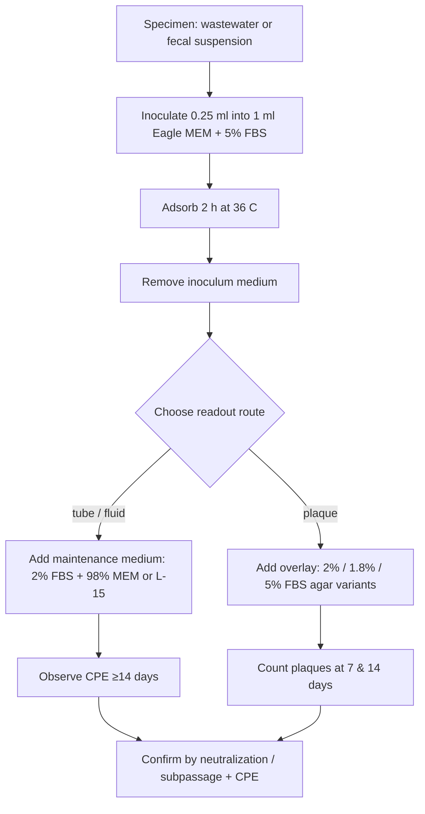

# VI107 — Summary (Schmidt, Ho, Riggs, Lennette 1978)

**Full cite:** Nathalie J. Schmidt, Helen H. Ho, John L. Riggs, Edwin H. Lennette. "Comparative Sensitivity of Various Cell Culture Systems for Isolation of Viruses from Wastewater and Fecal Samples." *Applied and Environmental Microbiology* 36(3):480–486 (1978). Viral and Rickettsial Disease Laboratory, California State Dept. of Health.

**Category (proposed):** Category 3 — methods/comparison. This is a **cell-system comparison study**, not a primary isolate report. Its question is *which cell line / vessel / overlay recovers the most enteric viruses from environmental samples*, not "we recovered virus X from this outbreak."

## What was done (experimental design)

Two phases:

1. **Wastewater survey (181 samples).** Samples from "Water Factory 21," Orange County, CA (secondary-effluent concentrates, ~50-gal reduced to 50–100 ml, or flocculated 1–2 gal). Each specimen inoculated **in parallel** into tube (fluid-medium), bottle-plaque, and petri-dish-plaque cultures across **five cell types**.

2. **Overlay/vessel comparison (fecal samples).** Fecal specimens that had already yielded enteroviruses were re-plaqued under **three different overlay media**, in **bottle vs. petri-dish** cultures of three monkey-kidney cell types.

## Cell types compared

| Cell line | Origin | Passage level |
|---|---|---|
| **RhMK** | Primary rhesus monkey kidney | primary |
| **MFK** | Fetal rhesus monkey kidney line (in-house) | 69th–75th (no longer diploid) |
| **BGM** | African green monkey kidney line (Barron et al.) | 127th–140th |
| **HFDK** | Human fetal diploid kidney line (in-house) | early |
| **RD** | Human rhabdomyosarcoma line | continuous |

## How FBS was manipulated (the key detail for R1)

This is the most FBS-explicit methods paper in the corpus. **FBS is changed at three distinct points**, and the paper *quantifies* why:

| Stage | FBS concentration | Purpose |
|---|---|---|
| **Inoculation / adsorption** | **5% FBS** (0.25 ml specimen into 1 ml Eagle MEM + 5% FBS, 2 h, 36 °C) | **Toxicity protection.** The paper states: samples adsorbed *without* FBS, or when the inoculum was *not removed* before adding maintenance medium, were "frequently toxic to cells." |
| **Maintenance (post-inoculation, fluid tube)** | **2% FBS + 98% Eagle MEM** (RD cells: 2% FBS + 98% Leibovitz L-15) | Standard low-serum maintenance. |
| **Plaque overlay (solid, three variants tested)** | **2% FBS** (overlay A, Dahling); **1.8% FBS** (overlay B, Wallis & Melnick mod.); **5% FBS** (overlay C) | Compared in parallel; isolation rates were similar (A=56, B=52, C=55 isolations). |

**Growth FBS is *not* stated numerically** — the paper refers to "standard procedures of this laboratory" for growing monolayers. So `fbs_coded=no` is correct (pre-inoculation growth % not given), but the *inoculation-era* FBS detail (5% adsorption → 2% maintenance) is unusually explicit.

## Flow of one isolation attempt

## Key results (for the corpus)

- 64 of 181 wastewater samples yielded virus. Very low virus concentration: most isolations were single-culture, single-plaque events (28 specimens produced only **1 plaque**).
- **Tube culture > plaque assay** for recovery: only 32 of 40 RhMK-tube-positive specimens also plaqued positive in RhMK.
- **Cell-line sensitivity is virus-specific** (no universal line):

| Virus group | Best cell line(s) (from Table 3) |
|---|---|
| Poliovirus | RD (3.8% positive attempts) |
| Group A coxsackievirus | HFDK (2.2%), RD (1.7%) |
| Group B coxsackievirus | BGM (2.8%) |
| Echovirus | RD (6.0%), RhMK (5.9%) |
| Reovirus | RhMK (1.8%), MFK (1.3%) |

- **BGM cells produced "false plaques"** — necrotic foci resembling virus plaques from toxic particulates, from which *no virus could be recovered* (6/18 virus-negative samples, vs 1/18 in RhMK). The authors explicitly warn that plaque counts in BGM could be **misread as virus** if identity is not confirmed.

## Why this matters to R1

- A methods-comparison paper, not a primary isolate — supports re-categorization to **category 3**.
- Provides a rare, explicit, quantified account of **FBS step-changes around inoculation** (5% adsorption → 2% maintenance) and the *rationale* (5% protects against toxicity, 2% is maintenance).
- Documents a concrete **CPE/plaque false-positive source** (toxic-particulate "false plaques") in a standard isolation readout — directly relevant to the R2/R3 confounding question.