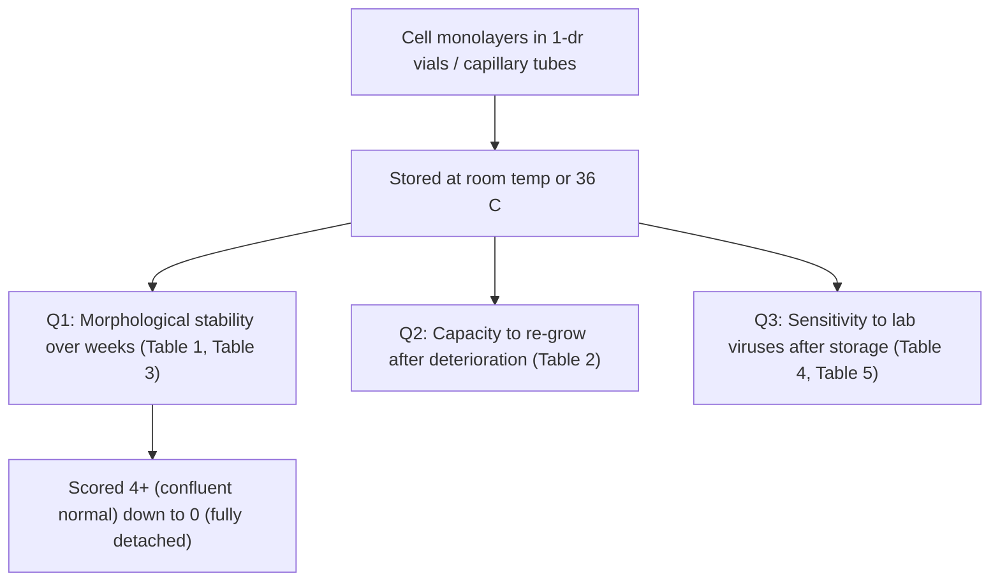

# VI117 — Summary (Deig, Rie, Watkins 1970)

**Full cite:** E. Frank Deig, Ivo P. Rie, Harry M. S. Watkins. "Miniature Cell Culture Systems for Use in Field Isolation of Viruses: Cell Stability and Sensitivity to Selected Laboratory-Propagated Viruses During Storage in Miniaturized Environments." *Applied Microbiology* 19(1):87–91 (1970). University of California, Naval Biological Laboratory, Oakland.

## The owner's question (answered)

**"Is this not an interesting experiment for us? Are all their cultures 'infected' or are some uninfected?"**

- **Yes, uninfected control cultures existed.** Line 94 of the paper states: *"Comparable uninfected cultures were maintained as controls."* So for the virus-sensitivity assays, there were parallel **uninfected** controls (to establish the baseline "healthy monolayer" morphology/gross appearance against which virus-induced change was compared).
- However, the **viruses used were all laboratory-propagated reference strains** — rhinovirus HGP, parainfluenza type 3, poliovirus type 2 — **not** field isolates from clinical specimens. The title itself says "Sensitivity to Selected **Laboratory-Propagated** Viruses." So this is a *cell-stability / method-feasibility* study, not a primary virus-isolation study.
- There is **no negative-control *morphology* experiment** of the kind R2/R3 would want (i.e., they did not show that storing an uninfected monolayer under maintenance-only conditions *produces* CPE-like changes). The uninfected controls were kept as *healthy* references, not to test whether maintenance/storage itself induces degeneration. (In fact they *do* document that stored cells degenerate morphologically over time *without* virus — see Table 1/Table 3 — but they treat that degeneration as a cell-viability endpoint, not as a "CPE-like" signal.)

## What was done

Two miniaturized culture formats were built and stress-tested for **field use** (epidemiological investigations in isolated regions where specimens can't be flown out before virus decays):

1. **1-dram (≈4 ml) screw-cap vials** with a portable 504-vial "honeycomb" roller rack.
2. **Capillary tubes (100 × 3 mm)** holding ~0.2 ml fluid columns.

## Cell lines and FBS (the R1-relevant detail)

| Cell line | Growth medium (FCS%) | Maintenance / virus medium |
|---|---|---|
| HESM (human embryo skin/muscle) | MEM + 10% FCS | L-15 + 1 or 2% FCS |
| HEL (human embryo lung) | MEM + 10% FCS | L-15 + 1–2% FCS |
| HEK (human embryo kidney) | MEM + 10% FCS | L-15 + 2% FCS |
| WI-38 (human diploid lung) | MEM + 10% FCS | L-15 + 2% FCS |
| MK (African green monkey kidney) | Melnick's + 5% FCS | L-15 + 1–2% FCS |
| HeLa | Hackett & McClain + 10% FCS | L-15 + 1–2% FCS |

- **Virus inoculation** was diluted in **L-15 + 1% FCS** (i.e., a low-serum maintenance medium at the moment of infection).
- So the paper shows the same **growth (5–10% FCS) → maintenance/inoculation (1–2% FCS)** step-down seen across the corpus.

## What they measured (three questions)

### Q1 — Morphological stability (cell degeneration *without* virus)

This is the single most R1/relevant finding. **Stored uninfected monolayers spontaneously degraded over time:**

| Cell line | Storage medium | Degeneration observed |
|---|---|---|
| HESM | L-15 + 1% FCS | 4+ at 29 d → 1+ (severe degeneration, many detached) at 88 d |
| HEL | L-15 + 2% FCS | 4+ at 27 d → 2+ (abnormal morphology) at 95 d |
| HeLa | L-15 + 2% FCS | 3+ at 7 d → **0 (complete degeneration) at 21 d** |
| All (capillary tubes) | L-15 / MEM ± FCS | **severe degeneration within 2 weeks** |

In other words: **monolayers placed in low-serum (1–2% FCS) maintenance at ambient temperature visibly round, degenerate, and detach over days-to-weeks with no virus present.** The authors read this as cell-viability loss, but the *observable morphology* (rounding, abnormal appearance, detachment) overlaps the vocabulary used for CPE.

### Q2 — Re-growth after deterioration

Cells that had morphologically deteriorated could sometimes re-grow when moved back to fresh growth medium (e.g., HEK 100%, WI-38 100% at 28 d; HESM 0% at room temp but 25% at 36 °C). Shows the degeneration was **partly reversible / environment-dependent**, not fixed.

### Q3 — Sensitivity to lab viruses after storage

Stored monolayers retained the ability to replicate rhinovirus, poliovirus, and parainfluenza 3 to titers comparable to fresh cells (e.g., rhinovirus 10⁷ TCID₅₀ on fresh vs 10⁶–10⁷ on stored; Table 4). Capillary cultures also synthesized virus to conventional levels (Table 5).

## Why this matters to R1 / R2 / R3

1. **Direct evidence that a low-serum maintenance "monolayer" can visibly degenerate with no virus** — exactly the class of observation the CRO experiment tests. (The authors frame it as cell stability; the morphology is CPE-adjacent.)
2. Uninfected **controls were present** in the virus-sensitivity assays, so the "infected vs uninfected" contrast existed — but the contrast was used to *confirm virus sensitivity*, not to *test whether maintenance itself mimics CPE*.
3. FBS step-down (growth 5–10% → maintenance/inoculation 1–2% FCS) follows the standard dual-media pattern.
4. Proposed category: **category 3** (methods/feasibility, laboratory-propagated reference viruses, no field isolates) — but it is a *substantively interesting* methods paper for the confounding question, not a disposable one.