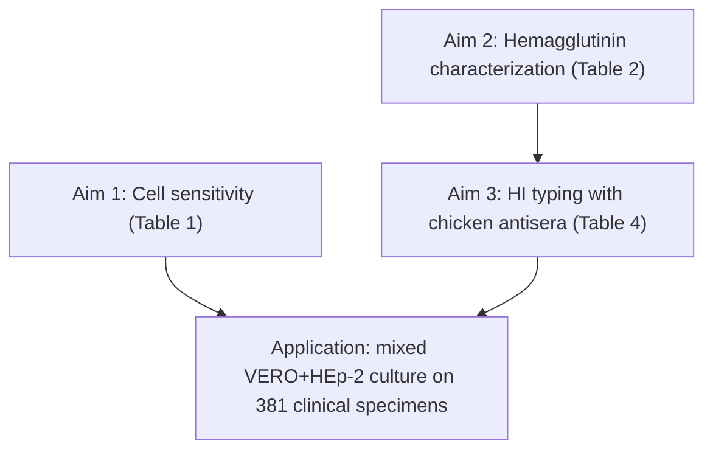

# VI225 — Summary (Numazaki, Shigeta, Ishida 1968)

**Full cite:** Yoshio Numazaki, Shiro Shigeta, Nakao Ishida. "Studies on Parainfluenza Virus Infections among Infants and Children in Sendai. I. Isolation and Identification Methods of Parainfluenza Viruses." *Japanese Journal of Microbiology* 12(3):275–281 (1968). Virus Laboratory, Sendai National Hospital / Tohoku University.

## Owner's note (confirmed)

"Same as VI252 and VI230" — i.e., a **cell-line-substitution methods study that performs genuine primary isolation**. Correct: the paper's *stated goal* is to find a cell line sensitive enough for parainfluenza viruses but free of the SV5/simian-virus contamination that plagues monkey-kidney (MK) cells. It does this by (a) testing VERO and HEp-2 against MK on prototype strains, and (b) **applying a VERO + HEp-2 "mixed culture" to 381 clinical specimens**, isolating 33 hemadsorption-positive viruses.

## What was done (three aims)

## Cells and FBS (R1-relevant)

| Cell | Growth medium | Maintenance (virus isolation) |
|---|---|---|
| MK (primary cynomolgus) | 0.5% lactalbumin hydrolysate + **5% bovine serum** | MEM + **2% bovine serum** |
| VERO | Earle's + 0.5% lactalbumin + 0.1% yeast extract + **15% bovine serum** | MEM + **2% bovine serum** |
| HEp-2 | MEM + **15% bovine serum** | MEM + **2% bovine serum** |
| **V-H mixed (VERO+HEp-2)** | MEM + **15% bovine serum** (mixed cell suspension) | MEM + **2% bovine serum** (day 3 exchange) |

So the pattern is growth **5–15%** → maintenance **2%** bovine serum, uniform across all cell types, applied at inoculation.

## Key result (application arm)

From 381 clinical cases, the mixed VERO+HEp-2 culture isolated **33 hemadsorption viruses:**

- 16 isolates could be serially propagated in VERO/HEp-2 (10 = parainfluenza type 2, 5 = mumps, 1 = parainfluenza type 3).
- 17 isolates could be passed **only to MK cells** (4 = parainfluenza type 1, 13 = parainfluenza type 3).
- Conclusion: the mixed VERO+HEp-2 system is "practical and useful" for isolation, though **less sensitive than MK** for some types.

Isolation rates in the 43 typed serodiagnosis-confirmed cases: type 1 = 4/9 (44.4%), type 3 = 14/24 (58.3%), type 2 = 10/10 (100%).

## R1-relevant notes

- **No explicit mention of uninfected negative-control cultures** in the isolation arm — this is routine clinical isolation with CPE + hemadsorption as the endpoints (consistent with standard practice of the era).
- A **hemagglutinin-based typing scheme** (green-monkey vs guinea-pig erythrocytes) is introduced to distinguish types without tissue-culture passage — evidence that lab serology (not CPE) is the identification step.
- Motivation is explicitly about avoiding **simian-virus contamination** in the substrate, not about the dual-media step — but the dual-media step is nonetheless applied.

## Category recommendation

**Keep in VI (category 1).** Genuine primary isolation of clinical parainfluenza/mumps isolates (381 specimens, 33 isolates), even though the framing is "evaluate a new cell system." No re-categorization.