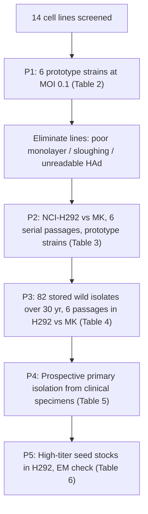

# VI252 — Summary (Castells, George, Hierholzer 1990)

**Full cite:** Empar Castells, Velma G. George, J. C. Hierholzer. "NCI-H292 as an alternative cell line for the isolation and propagation of the human paramyxoviruses." *Archives of Virology* 115:277–288 (1990). CDC, Atlanta.

## Owner's note (confirmed)

"This looks like virus isolation, but swapping the cell lines" — **correct.** The paper's *purpose* is to find a replacement for primary rhesus monkey kidney (MK) cells (supply/cost/endogenous-virus problems), but it does so by **performing actual virus isolation and propagation** — including a prospective primary-isolation arm on incoming clinical specimens. So it is a **cell-line-substitution study that contains genuine primary isolation** (Table 5), not a pure methods narrative.

## What was done (5 phases)

## Cell lines evaluated (14)

Human: L-132, A-549, NCI-H292 (HUT-292), HEK, Graham-293, G-401, A-498, A-704, CAKI-1, RD. Simian: MK (primary rhesus), LLC-MK2, BSC-1, MA-104, Vero-CCL81, Vero-76, Vero-76/E6.

**Winner: NCI-H292** (human lung mucoepidermoid carcinoma, ATCC CRL-1848) — the only line supporting all 6 paramyxovirus prototype strains (parainfluenza 1, 2, 3, 4A, 4B, mumps).

## FBS manipulation (R1-relevant)

| Stage | Medium |
|---|---|
| **Growth** | EMEM/10% FBS (or EMEM/7% FBS/1% ITS for in-house cells) |
| **First-trial maintenance** | Medium 199 + 2% FBS |
| **Later maintenance** | EMEM + 0.1% ITS + 1.5 µg/ml trypsin (**serum-free**) |
| **Final protocol** | RPMI-1640 + 1.5 µg/ml trypsin (**serum-free**; trypsin essential for replication in H292) |

So VI252 is a **serum-free maintenance** case: growth 10% FBS → inoculation/maintenance with trypsin-containing serum-free medium (RPMI-1640 or EMEM+ITS+trypsin). The 2% FBS (Medium 199) appears only in the *first* trial; the final protocol drops serum entirely in favor of trypsin. This matches the CSV's "10% growth / 2% first-trial maintenance" capture, but the *settled* regime is **10% → 0% (serum-free trypsin)**.

## Primary isolation result (Table 5)

Prospective comparison on incoming clinical specimens (H292 vs MK in parallel):

| Virus | Recovered in MK | Recovered in H292 |
|---|---|---|
| Parainfluenza 1 | 7 | 7 |
| Parainfluenza 3 | 13 | 13 |
| Mumps | 10 | 11 |

(No parainfluenza 2 / 4A / 4B circulated during the test window.)

## Notable R1-relevant observation

The authors explicitly note that **CPE across paramyxovirus types and strains overlaps** and is **not a reliable predictor of virus type**: *"…there was sufficient overlap in CPE descriptions between virus types and among strains of the same virus that CPE was not a reliable predictor of virus type."* CPE was read alongside hemadsorption (HAd), HA titer, EIA, and infectivity titration — i.e., CPE alone was acknowledged as non-specific even within a virus family.

## Category recommendation

**Keep in VI (category 1).** Although framed as an alternative-cell-line study, it performs genuine primary isolation (81/82 wild isolates and a prospective clinical arm), and it is a strong data point that the dual-media / serum-drop protocol is followed even when the cell line changes. No re-categorization.