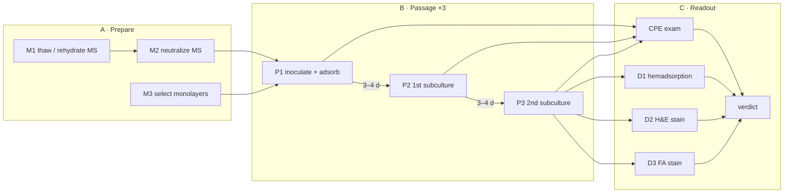
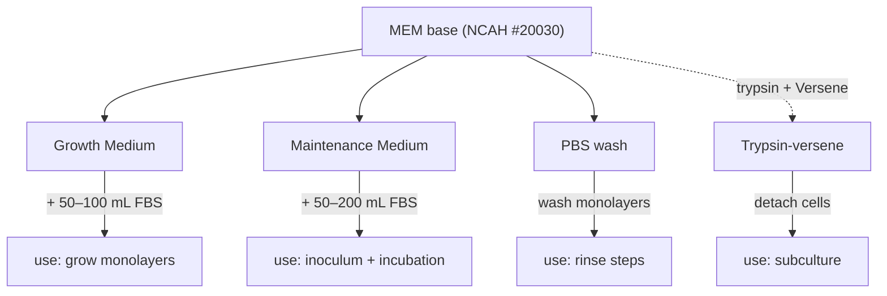
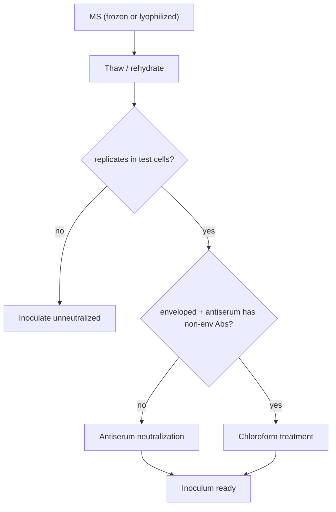
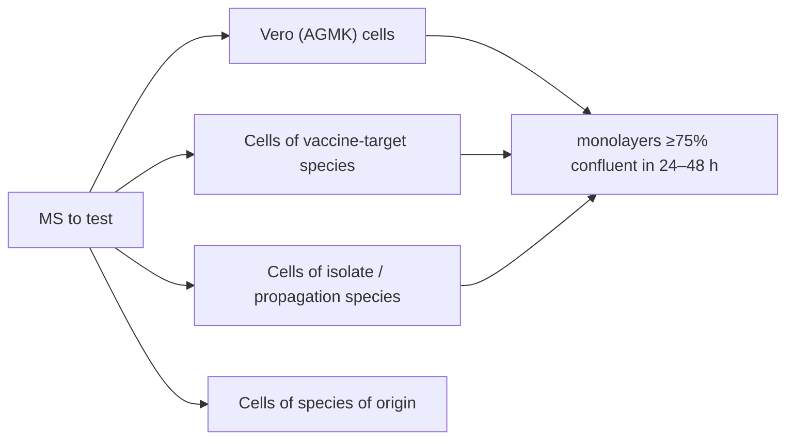
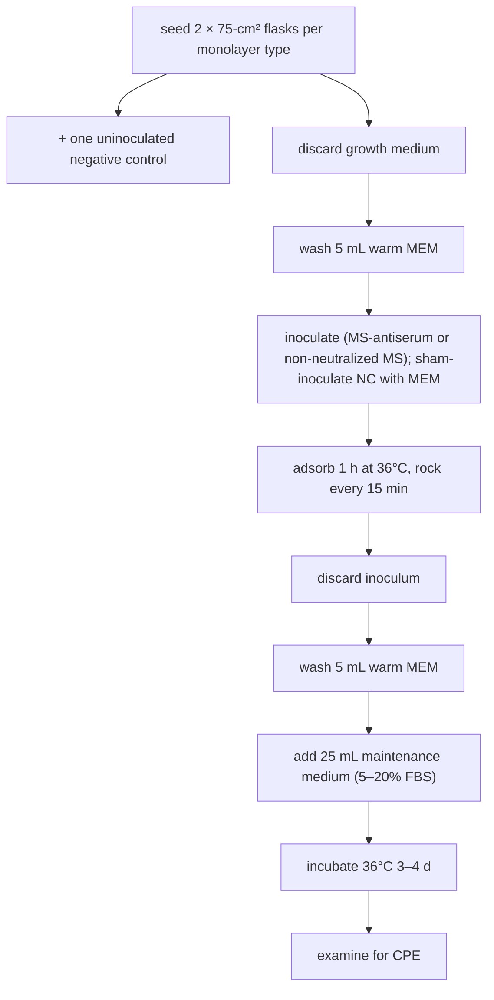
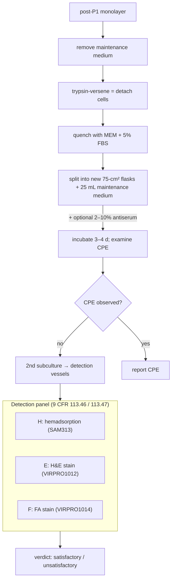
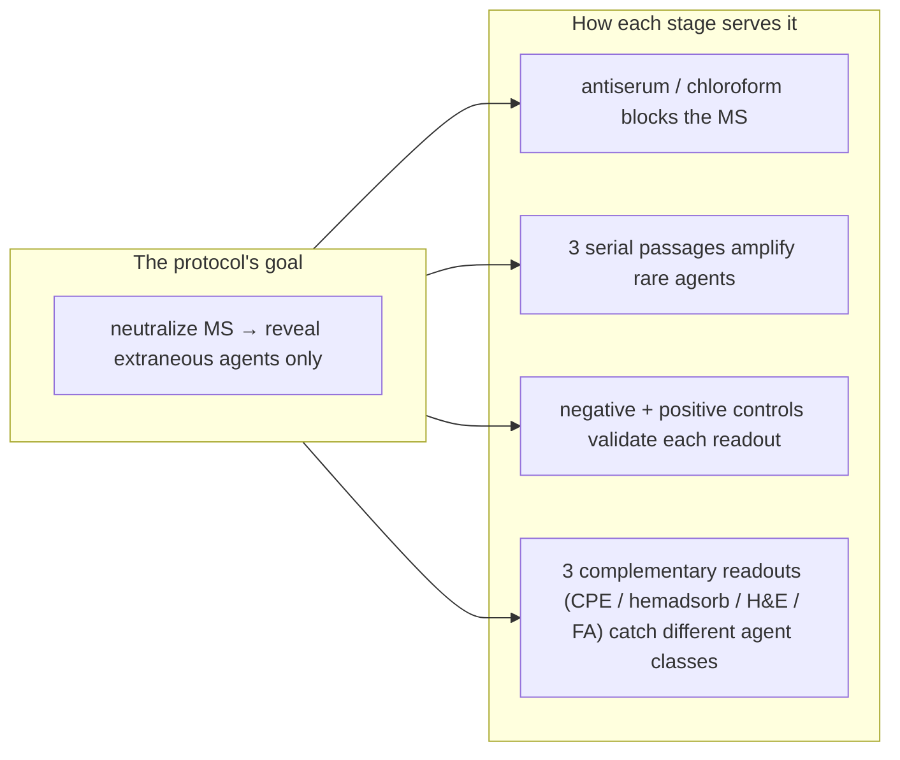

# VIRPRO1013.04 — Process diagrams

**Source:** USDA APHIS CVB VIRPRO1013.04, "Neutralization and Passage of Master Seed in Cell
Cultures" (Jan 9 2015; 21 pp). Full-text extract: `refs/_txt/APHIS_-_VIRPRO1013.txt` (gitignored).
All quotes verbatim from that document; section numbers (e.g. `§4.1.5`) are the protocol's own.

**Purpose of the protocol (¶1):** neutralize a vaccine *master seed* (MS), pass it serially in cell
culture, and detect **extraneous** agents (not the MS itself) via CPE + hemadsorption +
immunofluorescence, per 9 CFR 113.55 / 113.46 / 113.47.

**Reading the diagrams:** node labels carry a short ID (e.g. `N1`, `R6`). Supporting text — the
"what reagent, when, and why" — lives in the notes tables keyed to those IDs, so the diagrams stay
uncluttered. Each diagram's verbosity follows its step density; the high-level map (D0) is the bare
skeleton, and the rest add the per-step reagent/rationale detail.

---

## D0 — High-level process map

| ID | What happens | Why (protocol's rationale) |
|---|---|---|
| `M1` | Thaw frozen MS (36°C water bath) or rehydrate lyophilized MS; let equilibrate 15 min (§3.3.2) | Bring the seed to a workable liquid form before neutralization |
| `M2` | Neutralize MS with monospecific antiserum, or (alternative) chloroform/tetracycline (§3.3, §3.4) | Stop the MS from replicating so it cannot outgrow / mask / be mistaken for an extraneous agent |
| `M3` | Choose ≥3 monolayer types (§3.2) | Cover the cell species the MS could harbor an extraneous agent for |
| `P1` | Inoculate monolayer(s), 1 h adsorption, then add maintenance medium (§4.1) | Let any extraneous agent adsorb & begin infection |
| `P2` | Trypsinize & split into new flasks, add maintenance medium (§4.2) | Amplify any low-copy extraneous agent to detectable levels |
| `P3` | Second subculture, dispensed into detection vessels (§4.3) | Give the panel of detection assays matched material |
| `C1` | Regular microscopic CPE exam throughout (§4.1.9, §4.2.8, §4.3.4) | CPE is the primary evidence of an extraneous cytopathogenic agent |
| `C2–C4` | Hemadsorption / H&E / FA readouts at end (§4.3.1–3) | Confirm & identify extraneous agents (9 CFR 113.46 / 113.47) |
| `C5` | Satisfactory / unsatisfactory verdict | A MSV that fails any test may not be used; product from it may not be released |

---

## D1 — Media & reagent preparation (§2.2.8–2.2.12)

| ID | Recipe (verbatim gist) | Why / role |
|---|---|---|
| `MEM` | 9.61 g MEM (Earle's salts) + 2.2 g NaHCO₃ in 900 mL DI; + 5 g lactalbumin hydrolysate or edamine; pH 6.8–6.9; 0.22 µm filter; + L-glutamine, gentamicin (§2.2.8) | The shared basal medium; antibiotic + glutamine keep the culture viable & sterile |
| `GM` | 900 mL MEM **+ 50–100 mL γ-irradiated FBS** (~5–10%) (§2.2.9) | Grow the monolayer(s) to ≥75% confluence before inoculation |
| `MM` | 900 mL MEM **+ 50–200 mL γ-irradiated FBS** (~5–20%) (§2.2.10) | Feed cells through the 3–4 day observation windows after inoculation (CPE is read in this medium) |
| `PBS` | Na₂HPO₄ / NaH₂PO₄·H₂O / NaCl, pH 7.2–7.6 (§2.2.11) | Neutral rinse (used in SAM312 hemadsorption wash, not the main VIRPRO1013 flow) |
| `TV` | 0.5 g irradiated trypsin + 0.2 g Versene (EDTA) + salts/dextrose/phenol red (§2.2.12) | Detach the monolayer for each subculture (P2, P3) |

> **Note (the serum asymmetry):** the growth range (~5–10%) and the maintenance range
> (~5–20%) overlap and the maintenance top exceeds growth top — serum may *hold or increase*
> between growth and inoculation/observation. The protocol gives **no rationale** for the
> maintenance level (see `R4_VIRPRO1013_SAM312_extraction_notes.md`; coded LM035).

---

## D2 — Prepare & neutralize the master seed (§3.3–3.4)

| ID | Step (verbatim gist) | Why |
|---|---|---|
| `T` | Frozen MS thawed at 36°C; lyophilized rehydrated per manufacturer, equilibrate 15±2 min (§3.3.2) | Liquid seed for downstream handling |
| `G` | "If the MS is capable of replicating in the cell or culture system… it must be neutralized" (§3.3) | Otherwise the MS would itself produce CPE and be indistinguishable from an extraneous agent |
| `AB` | 1 mL MS + 1 mL heat-inactivated (56°C/30 min) monospecific antiserum; vortex; incubate 36°C 60–120 min (§3.3.3–6) | Antibody blocks the MS, leaving any extraneous agent free to infect |
| `CH` | 0.1 mL chloroform / mL MS (glass); vortex 5 min; centrifuge 1295×g 15 min 4°C; harvest supernatant (§3.4) | Kills enveloped MS so non-enveloped extraneous agents (matching antiserum cross-antibodies) can be detected |

> Antiserum must be (a) raised against antigen **not** from the MS lineage, (b) free of antibodies
> to *potential contaminants*, (c) free of non-specific inhibitors/complement (§3.3 "Requirements").

---

## D3 — Determine the culture system (§3.2)

| ID | Monolayer required | Why |
|---|---|---|
| `B` | Vero (African green monkey kidney) cell line | Universal permissive substrate (§3.2 "Vero") |
| `C` | Species for which the vaccine is recommended | Detect agents that would infect the target host |
| `D` | Species in which the MS was isolated and/or propagated | Detect agents from the seed's production lineage |
| `E` | Species from which the virus was obtained | Detect agents of the original host |

> Cells must pass 9 CFR 113.51 / 113.52 qualification. Vero is also tested for rabies, reovirus,
> BVD, and bluetongue (BT) (§3.2, per 9 CFR 113.47).

---

## D4 — First passage: inoculate & adsorb (§4.1)

| ID | Step | Why |
|---|---|---|
| `F`/`G` | Two 75-cm² flasks per cell type; one uninoculated flask reserved as negative control (§4 ¶intro) | Parallel sham control to distinguish agent effect from handling/medium effect |
| `D1`/`W1` | Discard growth medium; wash with warm MEM (§4.1.1–2) | Remove growth serum before inoculation |
| `IN`/`AD` | Inoculate ≥1 mL (or MS-antiserum mix); adsorb 1 h at 36°C, rock every 15 min (§4.1.3–4) | Let extraneous agents bind/enter cells |
| `D2` | "Discard inoculum following one hour adsorption to **reduce serum toxicity** and remove possible unneutralized residual MS virus" (§4.1.5) | Remove the inoculum's own serum (incl. antiserum) so it does not damage the monolayer |
| `MM` | "Add 25 mL of maintenance medium containing 5-20% of FBS" (§4.1.7) | Feed cells during the CPE-observation window |
| `INC`/`EX` | Incubate 3–4 d; "Examine … routinely … for evidence of cytopathic effect (CPE)" (§4.1.8–9) | Primary detection of cytopathogenic extraneous agents |

> Note (§4.1.6 note): monolayers **not** treated with antiserum, and their negative controls, skip
> the post-adsorption discard & wash step.

---

## D5 — Second & third passage, then detection (§4.2–4.3)

| ID | Step | Why |
|---|---|---|
| `R` | Remove maintenance medium at 3–4 d post-inoculation (§4.2.1) | Prepare for subculture |
| `T2` | 5 mL trypsin-versene rinse, then fresh 5 mL, incubate ~10 min until cells detach (§4.2.2–3) | Harvest cells for passaging |
| `Q` | "Add 2-3 mL MEM with 5% FBS … to inactivate the trypsin" (§4.2.4) | Stop trypsin before it damages the cells |
| `S2` | Dispense into new 75-cm² flasks with 25 mL maintenance medium; retain reserve stock at −70°C (§4.2.5) | Amplify; keep backup material |
| `I2` | Optional "Monospecific antiserum (2-10%) may be added … to prevent MS breakthrough" (§4.2.6); incubate 3–4 d; examine CPE (§4.2.7–8) | Keep the MS neutralized through the passage |
| `P3` | "If CPE is not observed," subculture a 2nd time into the detection vessels (§4.3) | Provide matched material for readouts |
| `HA` | Hemadsorption: MSV + negative-control flasks + 2 Vero positive-control flasks (PI3), read at 4°C & 25°C (§4.3.1) | Detect extraneous *hemadsorbing* agents |
| `HE` | H&E: 1 MSV slide + negative + 2 positive (intra-cytoplasmic / intra-nuclear inclusion viruses) (§4.3.2) | Detect intracytoplasmic/intranuclear inclusion agents |
| `FA` | FA: 1 MSV slide + negative + positive per agent; ≥6 cm² each (§4.3.3) | Identify specific extraneous viral antigens |
| `VER` | A MSV "found unsatisfactory by any prescribed test shall not be used" (§113.55) | Release decision |

> `§4.3.4` note: if CPE **or contamination** appears in either the inoculated *or uninoculated*
> monolayer during the 14-day window, it is reported for confirmation — the negative control is the
> validity check, and its CPE would itself flag the test.

---

## Cross-cutting purpose summary (why each stage exists)

