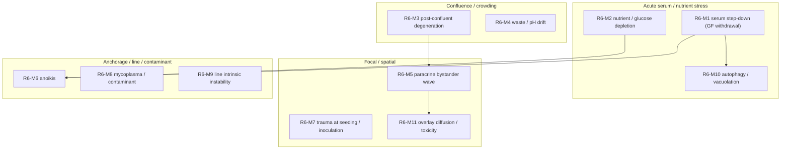

# R6 — candidate non-viral mechanisms of CPE/plaque morphology (living framework)

**Role:** The single enumeration of the generic, non-viral pathways by which an **uninoculated** monolayer can
show the readouts the field calls "CPE" and "plaques." Every candidate carries (a) a literature warrant, (b) the
CLSI M41 Table 7 descriptor(s) it reproduces, and (c) a **distinguishing prediction** testable against the
CRO/Zenodo record (Vero E6, no inoculum, 10% vs 2% FBS, 5 days, light + TEM) and the CRO-described term set.

**Scope.** This is the no-virus explanation developed on its own terms (AX011: non-specificity ≠ non-existence).
It does **not** assert that any CPE/plaque method is *validated* or that no infectious agent exists.

**Evidence convention.** The mechanism list itself is `[IN-HOUSE]` reasoning until a given row's warrant is
backed by `[VERIFIED src]` full-text reads, recorded in `R6_useful.csv` + `R6_bibliography.md`. Cells still on
the wishlist are `[DATA REQUIRED]`.

## Anchor facts (re-read first)

The CRO serum-only result (OB024, OB025) is the datum every mechanism must be consistent with:

- On the 22 CRO-described frames, CPE-type terms were named on **1 of 9 Culture A (10% FBS)** vs **10 of 13
  Culture B (2% FBS)** frames; B's terms: rounded (8), dying cells (7), granularity (6), vacuolation (4),
  detached (2), refractile (1). `[SUPPLIER]/[IN-HOUSE]`
- Two blinded raters score more CPE in B than A (IR1, IR2; OB025). `[IN-HOUSE]`
- **Confluence correction (OB082).** Neither Culture A nor Culture B exceeded **~80% confluence** over the
  observation window, so the CPE-classified morphology arose in **sub-confluent** monolayers. This removes
  post-confluent degeneration (R6-M3) as an explanation of the CRO result and strengthens the serum/nutrient
  withdrawal mechanisms. `[SUPPLIER]/[IN-HOUSE]`

So the leading mechanisms must predict: **more rounding / dying cells / granularity / vacuolation / detachment
in 2% than in 10% FBS within ~5 days, in a sub-confluent anchorage-dependent monkey epithelial line (Vero E6).**

## Mechanism table

| Code | Mechanism | Reproduces (CLSI Table 7) | Focal vs uniform | Distinguishing prediction vs CRO/Zenodo |
|------|-----------|---------------------------|------------------|------------------------------------------|
| **R6-M1** | Abrupt serum / growth-factor step-down (10%→2%) → loss of survival signals → mitochondrial/Bax apoptosis | rounded · granularity · degeneration · detachment | uniform (density-modulated) | Onset within 1–3 d of the switch; **dose-dependent on the drop magnitude** → B (2%) > A (10%), matching OB024/OB025. Cells adapted to the *higher* serum are *more* vulnerable to withdrawal (Vander Heiden 2001). |
| **R6-M2** | Nutrient / glucose / glutamine depletion → glycolytic substrate loss → mitochondrial apoptosis | rounded · granularity · degeneration · detachment | uniform, later onset | Appears later (when medium exhausts), **accelerates at high density/confluence**, correlates with medium colour (phenol red → yellow = acid). B's lower serum → slower growth but also lower buffering/replenishment. |
| **R6-M3** | Confluent / post-confluent degeneration (contact inhibition → "stop growing, start to die") | degeneration · detachment | uniform | **Excluded for the CRO result** — neither arm reached >80% confluence (OB082). Retained as a generic mechanism (Ammerman 2008: Vero "stop growing and start to die" at confluence) but it cannot explain *this* experiment; a discriminator, now moot for CRO. |
| **R6-M4** | Metabolic waste / pH drift (lactate, NH₃ → acidification) | granularity · degeneration · detachment | uniform | Correlates with medium colour; buffered by refeeding; both arms but **B acidifies faster** (less serum bicarbonate). CLSI M41 §5.3.2 ties refeeding to pH < 7.0. |
| **R6-M5** | Paracrine "bystander" / spreading-wave death (a dying cell poisons neighbours → expanding focal clearing) | all, organised as a **focus** | **focal (plaque-like)** | Focal lesions **expand radially** from a nidus with an adjacency gradient (dead centre → dying rim → healthy). Produces countable "plaques" with no virus. Distinguish from viral plaques only by kinetics/absence of particle, not by shape. |
| **R6-M6** | Anoikis / anchorage-signal loss → rounding + detachment + apoptosis | rounded · detached | uniform → floating | Rounding **precedes** detachment; floating cells; rescued by matrix/re-adhesion. Fibronectin/adhesion loss documented in Vero nutritional stress (CBI 1998). |
| **R6-M7** | Freeze–thaw / desiccation / mechanical trauma at seeding or inoculation | degeneration (localised) | **focal, non-progressive** | Focal death at trauma sites; **non-progressive**; **not serum-dependent**. A nil control for the "spreading plaque" claim. |
| **R6-M8** | Mycoplasma / microbial contaminant | granularity · vacuolation · degeneration · (mimics viral CPE) | mixed | **Persistent across passages**, not cleared by pen/strep; detectable by PCR/Hoechst/agar. Does **not** by itself explain a clean serum-dependent A vs B differential (which is only on one stock, split into two arms). |
| **R6-M9** | Cell-line intrinsic instability (aneuploidy → spontaneous degeneration foci) | nonspecific degeneration | **focal, sporadic** | Baseline "foci"/heterogeneity present in **healthy** cultures; **passage-dependent**; not serum-dose-dependent. |
| **R6-M10** | Starvation-induced autophagy → cytoplasmic vacuolation | **vacuolation** | uniform → localised | **Vacuoles appear with starvation, reverse on re-feed**; serum/nutrient-dependent → predicts more vacuolation in B, matching CRO "vacuolation (4)" in B. |
| **R6-M11** | Overlay-dependent effects (agarose/CMC/Avicel diffusion limitation + overlay toxicity + nutrient trap) | degeneration (organised as clearing) | **focal under overlay** | A "plaque" (zone of clearing) arises from **localised death + restricted waste/nutrient diffusion** under overlay, independent of virus; plaque size/border varies with **overlay composition** (agarose % , agaropectin inhibitors, medium MEM vs DMEM/glucose). |
| **R6-M12** | Osmotic / ionic stress (hyperosmolar overlay, medium-shift, cation chelation) | detach · granularity · degeneration | uniform or focal | Tied to a defined osmotic/ionic perturbation; absent in an isosmolar control. |

## Two framing points (load-bearing for the paper)

1. **"One plaque = one infectious particle" is an *inference from dilution-linearity + co-variance*, not a
   pattern-uniqueness proof.** Dulbecco (1952) secured it the only way the assay can: plaque count is **linear
   in virus concentration** ("A linear dependence of the number of plaques on virus concentration can be obtained
   only if each plaque is produced by one virus particle"), plaques are **absent when virus is absent**, and are
   reduced by **antiserum**, and there is a **~1:1 plaque:egg-infectivity** correspondence `[VERIFIED src]`.
   Fenner's chapter states the same coin plainly ("each infective particle gives rise to a localized focus…
   Infection with a single virus particle is sufficient to form a plaque") and the WNV protocol calls the PFU
   count what it is "theoretically" `[VERIFIED src]`. The precise R6 point is therefore **not** "the equivalence
   was never shown" but: dilution-linearity of the focal-clearance count in inoculum concentration proves *one
   discrete seeding unit per plaque*, and the "viral" reading of that unit is supplied by the surrounding
   inoculum/infectivity warrant — not by the focal pattern, which has non-viral producers (R6-M5, M7, M9, M11).
   Also note Dulbecco's negative-control caveat: "absent when the virus is absent" held under *his* conditions
   (chicken fibroblasts, agar overlay, adequate medium), not under the low-serum maintenance step that is this
   paper's confound (TH040/OB082).

2. **Focal clearing is a generic spatial pattern of localised death + diffusion constraint.** Plaque theory
   (Abedon & Yin 2009) treats plaque growth as diffusion-limited: plaque size is governed by a "hindered
   diffusion constant," agar density, and the "rates of nutrient and waste-product diffusion," and — decisively
   for R6 — "**plaque formation failure is not necessarily equivalent to virion inviability**" `[VERIFIED src]`.
   The Shigella-plaque precedent (Oaks et al. 1985) further documents a *bacterial* intracellular-replicator
   plaque assay in HeLa whose plaque diameter was set by **medium nutrient content (glucose; MEM vs DMEM)** —
   i.e. plaque size is medium-controlled even for a bona fide replicator `[fetched — extract next]`.

## Status and next

| Item | Status |
|------|--------|
| Mechanism list (12) | Drafted `[IN-HOUSE]`; warrants being filled in `R6_useful.csv` |
| M1 (GF withdrawal) | `[VERIFIED src]` Vander Heiden 2001 (IL-3 line); Vero side anchored by Quesney 2001 + Engelhardt & Mao 1977 (fetched) |
| M2 (nutrient) | `[VERIFIED src]` Vander Heiden 2001 (glucose); **Mendonça 2009** (Vero nutrient-depletion EM/light) |
| M3 (confluence) | `[VERIFIED src]` Ammerman 2008; **excluded for CRO by OB082** |
| M5 (bystander wave) | `[DATA REQUIRED]` — primary pending |
| M11 (overlay) | `[VERIFIED src]` Fenner, Abedon & Yin 2009, Dulbecco 1952; Cooper 1984 & Oaks 1985 fetched |

*End of mechanism framework (v0.1, 2026-11-17).*
