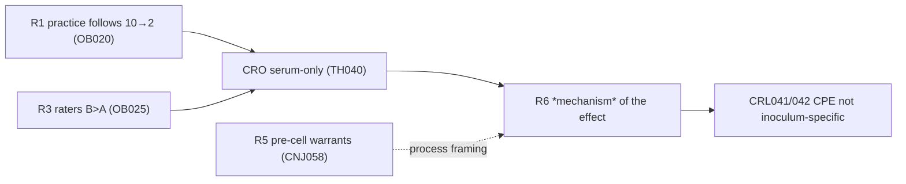

# R6 — Non-viral mechanisms of CPE/plaque morphology (research stream)

**Folder:** `r6_nonviral_morphology_mechanisms/`
**Role:** Develop and test the assumption that **the inoculum held no virus / no disease-causing agent**, and ask:
by what **cell-biological mechanisms** do the readouts the field calls "cytopathic effect" and "plaques" — foci of
cell rounding, detachment, degeneration — actually form? Under the no-virus assumption, a plaque is a locally
countable region of cell death; what produces that region, and what predicts its size, shape, timing, and serum
dependence?

**Status:** **Scaffold + Round 1 seeds (2026-11-17).** Mechanism framework drafted; three full-text anchors read
(`[VERIFIED src]`); wishlist + bibliographies + CSVs open. **Not yet load-bearing for the paper.**

**Why this stream exists.** R5 audits the *pre-cell-culture* warrants; R6 audits the *cell-culture endpoint's
mechanism* under the no-virus hypothesis. It is the mechanistic underside of the CRO experiment (Vero E6, no
inoculum, 10% vs 2% FBS → CPE-classified morphology) and an extension of R3 (CPE morphology). It is **not** a
claim that no infectious agent exists (see AX011: non-specificity ≠ non-existence) — it is the development of the
no-virus explanation on its own terms, to be tested against the CRO/Zenodo data and the CLSI M41 Table 7 descriptor
set. **Guardrail:** R6 may draw temporal/process connections to R5 and the CRO result but **never states or
insinuates that the CPE/plaque methods are validated.**

## Scope

- Candidate non-viral mechanisms of focal/complete monolayer degeneration: serum step-down stress, nutrient
  depletion, metabolic waste, pH drift, osmotic/mechanical stress, senescence, contact inhibition → detachment,
  freeze–thaw/desiccation at the inoculation step, cell-line intrinsic instability, "spreading wave" of
  paracrine death (one dying cell poisoning neighbours), mycoplasma/contaminant in the line, overlay effects, etc.
  Full enumeration + distinguishing predictions: `R6_mechanisms.md`.
- Literature survey of what is *actually known* about uninoculated monolayers degenerating under maintenance
  media and under solid overlays.
- Whether "one plaque = one infectious particle" is an assumption or a demonstrated fact under the no-virus view.

## Entrypoints

| File | Use |
|------|-----|
| `r6.md` | This file — scope, TODO, Snippets |
| `R6_research.md` | Search protocol (scope, assumptions, inclusion, schema, rounds, stop criteria) |
| `R6_mechanisms.md` | **Live framework** — R6-M1…R6-M12 with warrants + distinguishing predictions |
| `R6_screened.csv` | Every source screened (`id, year, short_cite, lead_source, model_cell_line, useful, reason, fulltext, round, notes`) |
| `R6_useful.csv` | Extraction rows (mechanism schema below `R6_research.md` §5) |
| `R6_bibliography.md` | **Used** bibliography (fetched + read + used) |
| `R6_bibliography_unused.md` | **Read-but-unused** bibliography |
| `R6_pdf_wishlist.md` | Fetch-only queue (**gitignored**, local-only) |
| `R6_search_log.md` | Round-by-round queries, decisions |
| `R6_synthesis.md` | Written only after extraction freezes (not yet created) |
| `refs/` | Local PDFs only (**gitignored**) |
| `_notes/` | Quote-sized text extracts from PDFs (tracked) |
| `wrk/` | Working journal + scratch (tracked) |

## TODO

1. [x] (new agent) Write `R6_research.md` protocol + `R6_pdf_wishlist.md` + `refs/` + `wrk/` + `_notes/` + bibs + CSVs.
2. [x] Enumerate candidate non-viral mechanisms with a way to distinguish each → `R6_mechanisms.md` (R6-M1…R6-M12).
3. [ ] Fetch full texts named in `R6_pdf_wishlist.md` into `refs/` (Albert drops; assistant confirms + removes rows).
4. [ ] Round 2 systematic per-mechanism queries (plan in `R6_research.md` §6).
5. [ ] Read Dulbecco 1952 + Cooper 1984 + Abedon & Yin 2009 → characterize "one plaque = one particle" (assumption vs demonstration).
6. [ ] Hunt R6-M5 (bystander / secondary-necrosis wave) primary — the focal "plaque" producer, currently `[DATA REQUIRED]`.
7. [ ] Confirm peer-review status of R6-004 (ResearchGate DOI) before any load-bearing use; get Vero-specific serum-nutrient primaries (R6-004/005/006/016/017).
8. [ ] Freeze → write `R6_synthesis.md`; add/update claims in `CLAIMS.md`; back Discussion wording with the mechanism table.
9. [ ] Note temporal/process connections to R5 and the CRO results; **never state the methods are validated.**

## Snippets (paper-ready prose)

### R6-S1 — what the stream can and cannot claim

> Under the working assumption that an inoculation step added no virus, the morphological readout the field
> calls "cytopathic effect" and the countable clearing it calls a "plaque" are — as observable morphology — a
> class of monolayer degeneration: focal or uniform cell rounding, vacuolation, granularity, detachment, and
> death. R6 develops the cell-biological mechanisms by which such morphology arises in an uninoculated culture;
> it does not assert that no infectious agent exists in any system.

### R6-S2 — the plaque step is an assumed equivalence, not a demonstration

> Standard descriptions of the plaque assay state that "each infective particle gives rise to a localized focus"
> and that "infection with a single virus particle is sufficient to form a plaque," and treat the plaque count as
> "theoretically" equal to the number of infectious particles. That equivalence takes as given what the focal
> pattern itself does not: that a locally countable zone of cell death under an overlay has, as its only
> producer, the spread of a self-replicating particle. The pattern is also produced by generic focal damage
> (trauma, intrinsic instability, contaminant) and is consistent with localized death under a diffusion-limiting
> overlay; the step from "a focusing clearing" to "one particle per clearing" is therefore the assumption R6
> examines, not an independently demonstrated fact.

### R6-S3 — a serum step-down is a growth-factor withdrawal stress

> A maintenance-medium switch (≈10% → ≈2% FBS) is, for the monolayer, an abrupt withdrawal of growth factors.
> Cells adapted to high growth-factor concentrations are documented to be *more*, not less, vulnerable to death
> upon abrupt withdrawal — cell death is triggered by the size of the drop, "even when the remaining growth
> factor is sufficient" to sustain cells lowered gradually — and the same mitochondrial apoptosis program is
> engaged by glucose/nutrient limitation as by growth-factor withdrawal. The low-serum maintenance arm is
> therefore expected, on mechanism alone, to show more rounding, granularity, and death than the growth arm —
> which is the direction the serum-only CRO cultures and the blinded raters report (OB024/OB025).

## Frame — where R6 sits in the argument spine

*Created 2026-11-17; scaffold + Round 1 seeds by the R6 agent.*
